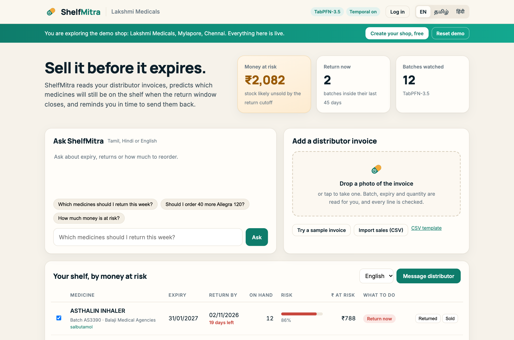
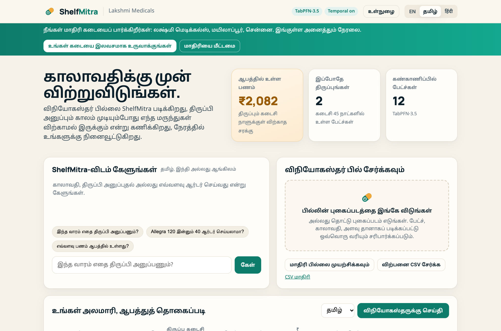
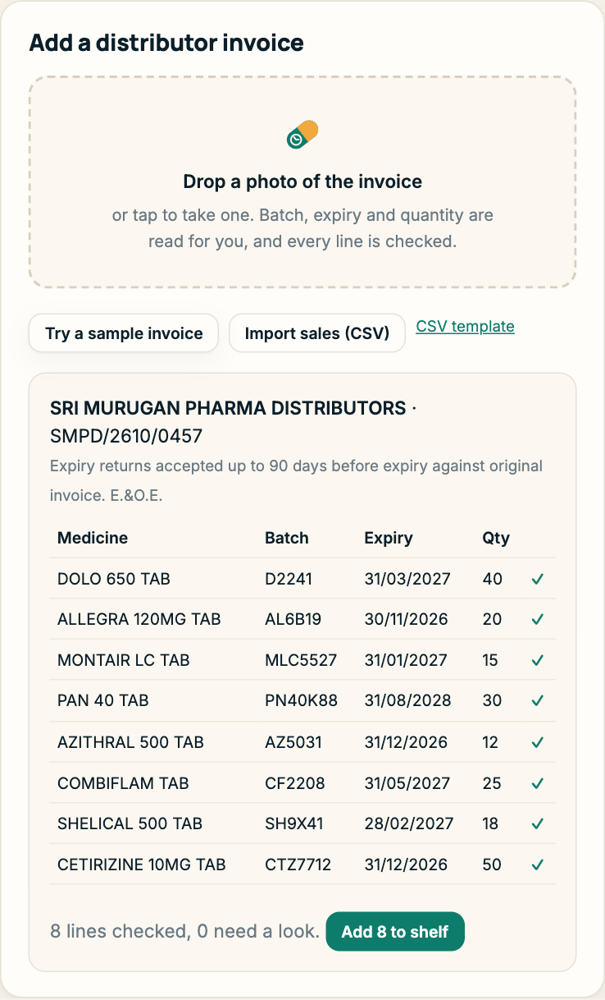
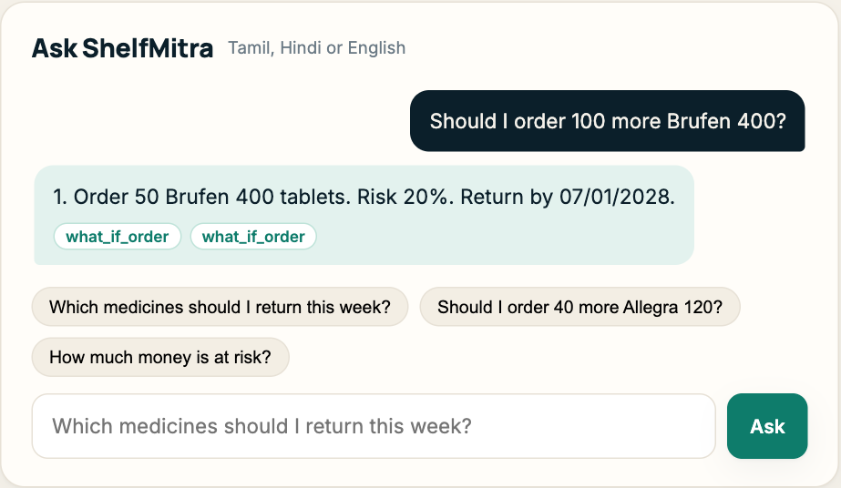
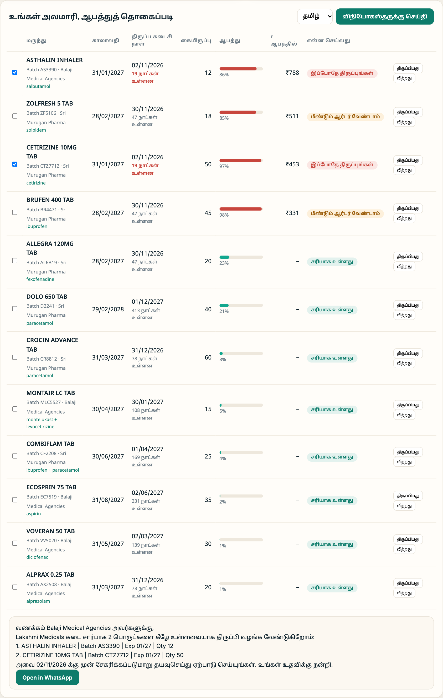
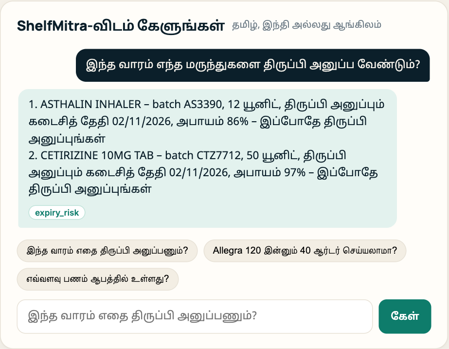
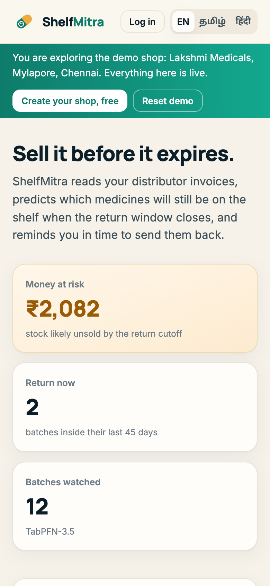
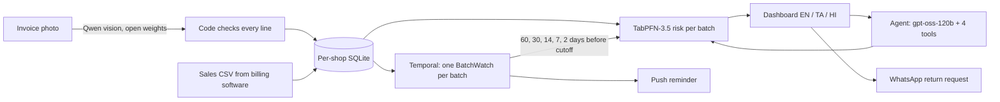
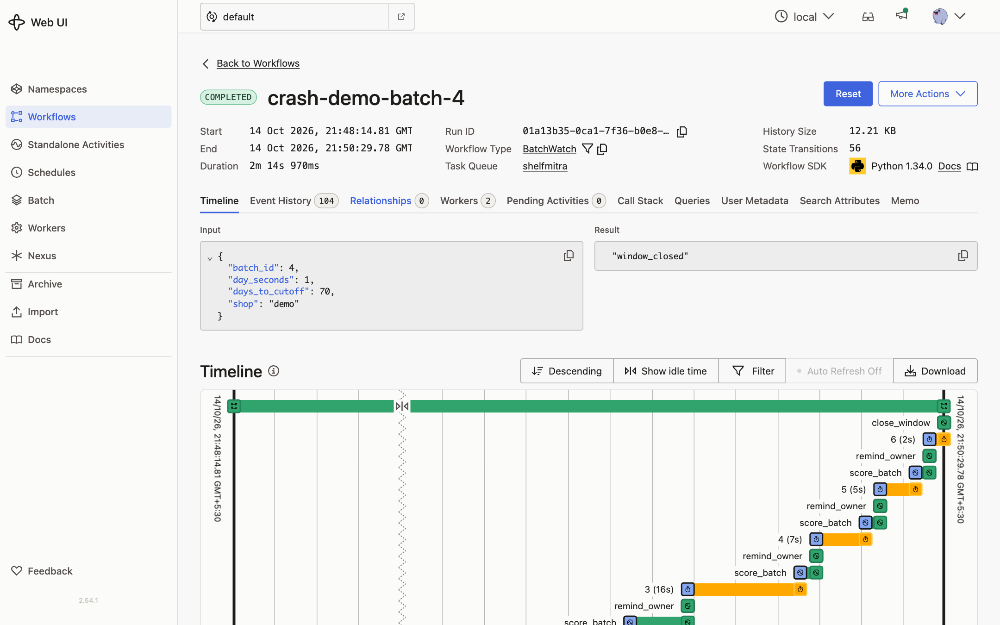

<p align="center"></p>

<h1 align="center">ShelfMitra</h1>

<p align="center"><b>Sell it before it expires.</b><br>
Expiry rescue for Indian medical shops, in Tamil, Hindi and English.</p>

<p align="center">
<a href="#run-it">Run it</a> ·
<a href="#how-it-works">How it works</a> ·
<a href="#does-tabpfn-actually-help">Eval</a> ·
<a href="#temporal-kill-the-worker-lose-nothing">Crash demo</a> ·
<a href="#limits">Limits</a>
</p>



## The problem

A neighbourhood medical shop buys from two or three distributors. Most distributors take expired or near-expiry
stock back, but only until a cutoff, usually 60 to 90 days before the printed expiry. After that the strip is
the shop's loss. Nobody has time to check the expiry of 2,000 batches against how fast each one sells, so the
cutoff passes quietly and the medicine goes in the bin.

ShelfMitra does that check for every batch, every day, and tells the owner which ones to send back while the
distributor will still take them.

## What it does

1. **Reads the distributor invoice from a photo.** An open-weight vision model (Qwen) copies the table. Plain
   code then checks every line: batch format, MM/YY expiry, whole-number quantity, `qty x rate = amount`,
   rate not above MRP. Any line that fails is flagged for the pharmacist instead of guessed. Brand names are
   matched to their active ingredient (Dolo 650 to paracetamol, Montair LC to montelukast + levocetirizine).
2. **Predicts which batches will still be on the shelf at the return cutoff.** TabPFN-3.5 scores each batch
   from its recent sales, quantity on hand and days left. The shelf is sorted by rupees at risk, not by date.
3. **Watches every batch until its cutoff.** One Temporal workflow per batch sleeps on durable timers and wakes
   at 60, 30, 14, 7 and 2 days before the cutoff, re-scores the batch with fresh sales and pings the owner only
   when it is at risk. It survives laptop restarts and worker crashes.
4. **Writes the return request.** Pick the batches, pick a language, and ShelfMitra fills a WhatsApp message to
   the distributor. The model writes the template once per language; code fills in every number.
5. **Answers questions in the owner's language.** "இந்த வாரம் எதை திருப்பி அனுப்பணும்?" or "Brufen 100 aur
   mangwaun?" goes to an agent (gpt-oss-120b) with four tools. Before advising on an order it runs TabPFN on the
   hypothetical batch, counting the stock already on the shelf.

| Tamil | Invoice read and checked | Order advice |
| --- | --- | --- |
|  |  |  |

| Return request in Tamil | Agent in Tamil | Phone |
| --- | --- | --- |
|  |  |  |

## How it works



The rule throughout is **the model reads, code decides**. Models transcribe invoices, write message templates
and phrase answers. Code validates the numbers, picks the action (return now, stop reordering, watch, fine)
and fills every figure the owner sees. The agent receives tool results already in rupees, percents and
DD/MM/YYYY dates in the owner's language, so it has nothing to convert and nothing to invent.

| Part | Open model or tool | Where |
| --- | --- | --- |
| Invoice reading | Qwen 3.8 27B (vision), or qwen2.5vl:3b on Ollama offline | [invoice.py](shelfmitra/invoice.py) |
| Risk | TabPFN-3.5, local CPU | [risk.py](shelfmitra/risk.py) |
| Agent and messages | gpt-oss-120b, or qwen3:4b on Ollama offline | [agent.py](shelfmitra/agent.py), [messages.py](shelfmitra/messages.py) |
| Durable reminders | Temporal | [workflows.py](shelfmitra/workflows.py) |
| Accounts | PBKDF2 passwords, signed cookies, one database per shop | [auth.py](shelfmitra/auth.py), [store.py](shelfmitra/store.py) |

## Does TabPFN actually help?

I built a benchmark from real pharmacy sales before trusting it. The data is the public
[Pharma sales data](https://www.kaggle.com/datasets/milanzdravkovic/pharma-sales-data) set: six years of daily
sales across eight drug classes from one pharmacy. [eval/run_eval.py](eval/run_eval.py) drops simulated
batches into that history (random quantity, random days to cutoff) and asks: will more than 10% of this batch
still be on the shelf at the cutoff? Training scenarios come from 2014 to 2017, test scenarios from 2018 to
2019, five seeds each.

| Method | Training batches | ROC-AUC | F1 |
| --- | ---: | ---: | ---: |
| Straight-line rule (sales rate x days left) | none | 0.903 | 0.849 |
| Logistic regression | 500 | 0.908 | 0.863 |
| Gradient boosting | 500 | 0.922 | 0.858 |
| TabPFN-3.5 | 50 | 0.895 | 0.833 |
| TabPFN-3.5 | 100 | 0.909 | 0.849 |
| TabPFN-3.5 | 200 | 0.920 | 0.858 |
| **TabPFN-3.5** | **500** | **0.949** | **0.882** |

The honest reading: the simple rule is already strong, and that is why it is the fallback when TabPFN is not
available. TabPFN passes it from about 100 examples and is clearly ahead at 500, where the other learned models
are still close to the rule. Full table with every size in [eval/results.md](eval/results.md).

## Temporal: kill the worker, lose nothing

[scripts/crash_demo.py](scripts/crash_demo.py) starts a watch on one batch with a day shrunk to one second, kills
the worker with `SIGKILL` right after the first checkpoint, stays down while the next checkpoint falls due,
then starts a fresh worker.

```
[21:48:36] Checkpoint at 60 days left is done.
[21:48:36] Worker killed with SIGKILL. Nothing is running the watch now.
[21:49:14] Checkpoints recorded while the worker was dead: 0
[21:49:14] Fresh worker started.
[21:50:29] Workflow finished: window_closed

Checkpoints run, by days left: [60, 30, 14, 7, 2]  (expected [60, 30, 14, 7, 2])
```



The overdue checkpoint runs as soon as a worker comes back, and the watch carries on to the cutoff. Activities
retry with backoff forever, so a flaky model or network call delays a reminder instead of dropping it.

## Run it

```bash
git clone https://github.com/vignesh2027/shelfmitra && cd shelfmitra
python3 -m venv .venv && .venv/bin/pip install -r requirements.txt
cp .env.example .env    # add GROQ_API_KEY, TABPFN_TOKEN, HF_TOKEN
scripts/run_local.sh    # app on :8000, Temporal UI on :8233
```

You need the [Temporal CLI](https://docs.temporal.io/cli) for the local dev server. TabPFN-3.5 weights are gated:
accept the license at [ux.priorlabs.ai](https://ux.priorlabs.ai) and set `TABPFN_TOKEN`. Without it ShelfMitra
falls back to the straight-line rule and says so in the header.

To run fully offline with Ollama instead of hosted models, set `SHELFMITRA_LLM=local` and pull `qwen3:4b` and
`qwen2.5vl:3b`.

Tests: `.venv/bin/python -m pytest` (Temporal time-skipping tests for the watch, plus account isolation tests).

Deploy: [render.yaml](render.yaml) is a Render blueprint (Docker, 1 GB disk for the shop databases and Temporal's
state). Visitors land in a shared demo shop; signing up gives a private, empty shop.

## Limits

- Risk is a prediction, not a guarantee. Always check the physical stock before returning it.
- The benchmark is one pharmacy's sales, with simulated batches on top. No public Indian pharmacy sales data
  exists that I could use; the demo shop's sales are that same data scaled to twelve common Indian brands.
- The pharma sales data is CC BY-NC 4.0. It is used for the evaluation and the demo shop only. A paid version
  has to fit TabPFN on each shop's own sales history instead.
- Return windows differ by distributor and are read from the invoice note when printed (default 90 days).
- ShelfMitra never suggests discounting prescription medicines or selling them without a prescription.

## License

Code: MIT. Sales data in `data/raw`: CC BY-NC 4.0, see [data/raw/SOURCE.md](data/raw/SOURCE.md).
